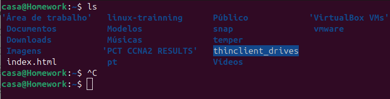

# Projeto-1: Transferência de arquivos linux x Windows

## Instalação do Debian com Webserver

## Instalação do Windows10

## Instalação do WinSCP 

## Instalação do PUTTY

## Realização da comunicação

## Download do template web html 

## Transferência do template para webserver

## Teste do site

